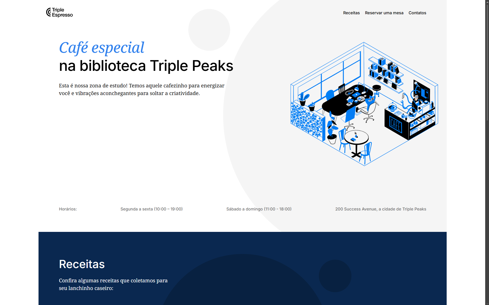

# Triple Espresso

Site de uma cafeteria fictícia localizada dentro da Biblioteca Triple Peaks.
Projeto 4 (HTML e CSS avançado) do curso de desenvolvimento web da TripleTen.

## Descrição e funcionalidades

- Cabeçalho com menu de navegação (links âncora para as seções), título,
  descrição, ilustração, horários e endereço
- Seção **Receitas** com dois vídeos do YouTube incorporados
- Seção **Reserva** com formulário (nome, número de convidados, data e hora,
  e-mail e termos de uso), todos os campos obrigatórios
- Rodapé com logo, redes sociais e direitos autorais
- Estados `:hover` nos links e no botão do formulário

## Tecnologias e técnicas utilizadas

- HTML5 semântico (`header`, `nav`, `main`, `section`, `footer`, `form`)
- CSS3: Flexbox, posicionamento relativo e absoluto, `z-index`, pseudo-classe
  `:hover`
- Metodologia BEM e estrutura de arquivos BEM Flat (um arquivo CSS por bloco
  na pasta `blocks`)
- `normalize.css` importado via `@import`
- Fontes Inter e Noto Serif (Google Fonts)
- Git e GitHub

## Planos de melhoria

- Tornar a página responsiva com media queries
- Adicionar validação e envio real do formulário de reserva com JavaScript
- Criar as páginas de Menu e Contatos
